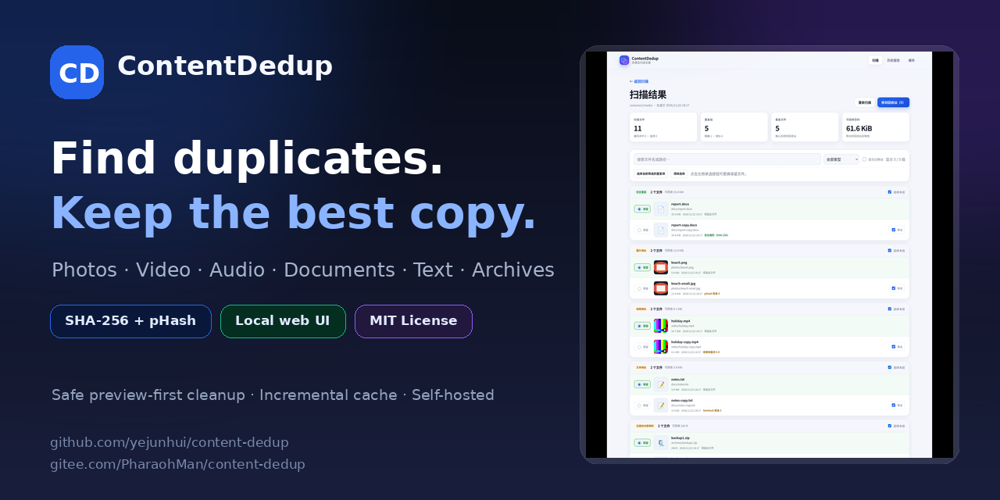
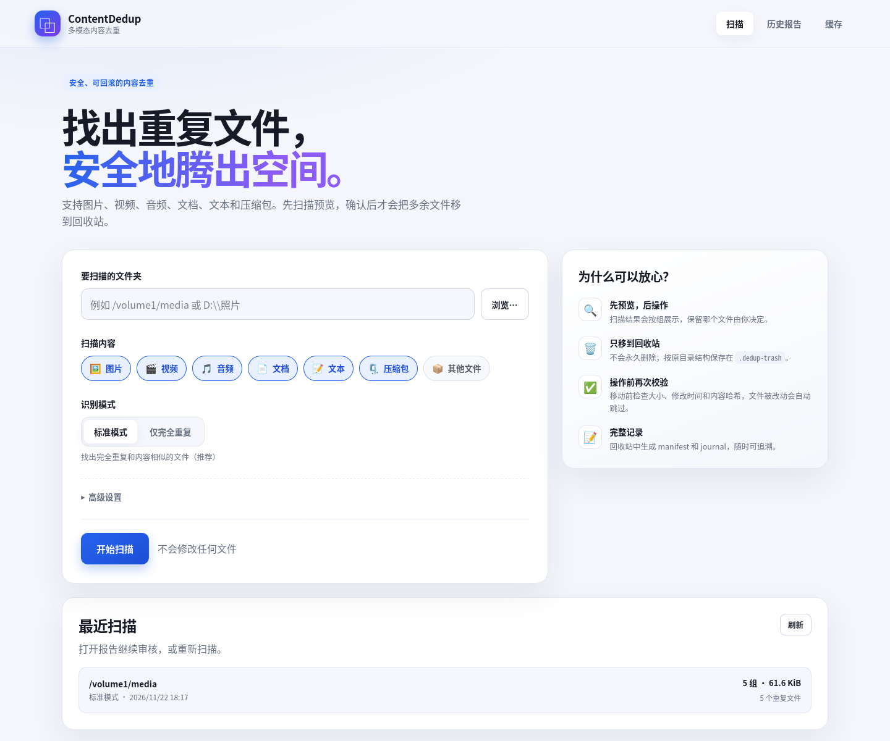
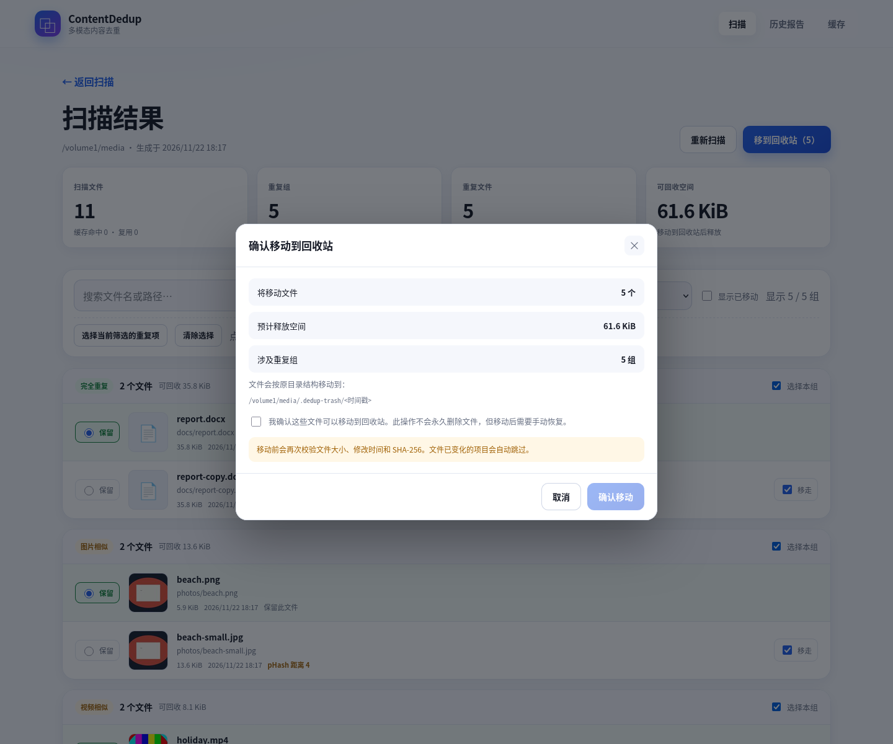
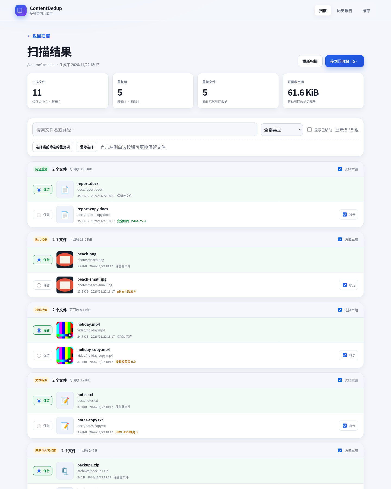

<div align="center">
  

  <h1>ContentDedup</h1>

  <p><strong>Local, safe, reversible multi-modal content deduplication</strong></p>
  <p>Images · Video · Audio · Documents · Text · Archives</p>

  <p>
    <a href="https://github.com/yejunhui/content-dedup/actions/workflows/ci.yml"></a>
    <a href="https://www.python.org/"></a>
    <a href="LICENSE"></a>
    <a href="Dockerfile"></a>
    <a href="https://gitee.com/PharaohMan/content-dedup"></a>
  </p>

  <p><a href="README.md">中文</a> · English</p>
</div>

> **Preview first, clean later.** ContentDedup finds byte-identical and
> perceptually similar files, lets you choose what to keep, and moves the rest
> into a trash directory. Everything runs locally. Nothing is uploaded.

[Full documentation (Chinese)](README.md)

## Why ContentDedup?

Most duplicate finders only compare bytes. ContentDedup understands content:

- 🖼️ PNG vs. recompressed/resized JPEG of the same photo
- 🎬 re-encoded video at a different resolution, matched by frame pHash sequences
- 🎵 the same track at different bitrates, matched with Chromaprint fingerprints
- 📄 PDF / DOCX / XLSX / PPTX / ODF / EPUB documents with near-identical extracted text
- 🗜️ repacked zip/tar archives with the same internal content
- 🧠 exact duplicates still use SHA-256 — fast and lossless

Built for normal users too:

- **Local web UI** with a folder picker, thumbnails, progress, cancel, and per-file review
- **Safe by default** — CLI cleanup is dry-run unless `--yes`; the web UI requires confirmation
- **Recycle bin, not delete** — preserves the relative path and writes a manifest/journal
- **Re-verifies every file** (size, mtime, SHA-256) before moving it
- **NAS-friendly** — SQLite incremental cache, staged scans, resource controls, Docker

## Screenshots

<p align="center">
  
  
</p>

<p align="center">
  
</p>

> The current web UI is in Simplified Chinese. CLI flags and JSON reports are
> language-neutral.

## Quick start

### Docker (recommended for NAS / servers)

```bash
git clone https://github.com/yejunhui/content-dedup.git
cd content-dedup
MEDIA_DIR=/volume1/media docker compose up -d
```

Open `http://<nas-ip>:8765/`. The image includes ffmpeg and Chromaprint `fpcalc`.
The media mount must be writable if you want to move duplicates into `.dedup-trash`.
The container runs as UID 1000; adjust `user:` or directory permissions if your NAS
media is owned by a different UID.

### Python + web UI

```bash
git clone https://github.com/yejunhui/content-dedup.git
cd content-dedup
python3 -m venv .venv
. .venv/bin/activate
pip install -e .

# Optional: video frames and audio fingerprints
sudo apt-get install -y ffmpeg libchromaprint-tools

./start-web.sh
# same as: dedup web --open
```

Open `http://127.0.0.1:8765/`.

### CLI

```bash
# Exact + perceptual fingerprints
dedup scan /volume1/media --types image,video,document \
  --report /volume1/reports/latest.json

# Exact duplicates only
dedup scan /volume1/media --mode exact --report /volume1/reports/exact.json

# Review, then clean
dedup report --report /volume1/reports/latest.json
dedup apply  --report /volume1/reports/latest.json          # dry run
dedup apply  --report /volume1/reports/latest.json --yes    # move to trash
```

Try a generated demo:

```bash
python examples/create_demo.py ./demo
dedup web --root ./demo --open
```

## Supported content

| Type | Exact | Structural / perceptual fingerprint |
|---|---|---|
| Images | SHA-256 | pHash/dHash + RGB histogram |
| Video | SHA-256 | frame pHash sequence + DTW + color gate |
| Audio | SHA-256 | Chromaprint (`fpcalc`), optional |
| PDF / Office / ODF / EPUB | SHA-256 | extracted text + SimHash |
| Text / code / Markdown | SHA-256 | SimHash + token shingles |
| ZIP / TAR / GZ / BZ2 / XZ | SHA-256 | internal manifest of path, size, SHA-256 |
| Other binaries | SHA-256 | exact only |

The semantic embedding layer (CLIP / text embeddings) is planned but not enabled
in this release.

## Safety

- CLI `apply` is dry-run by default. The web UI requires an explicit confirmation.
- Duplicates are moved to `<scan-root>/.dedup-trash/<timestamp>/`; nothing is deleted.
- Before moving, ContentDedup re-checks size, mtime, and SHA-256.
- `manifest.json` and `journal.jsonl` make every move traceable.
- The web server binds to `127.0.0.1` by default and has no authentication yet.
  Use `--root` to restrict access, and never expose it directly to the internet.
- On NAS, take a Btrfs snapshot before cleanup.

## Architecture

```text
src/dedup/
├── adapters/         # image, video, audio, document, text, archive, binary
├── fingerprints.py   # pHash, dHash, SimHash, DTW, audio similarity
├── index.py          # banded Hamming index
├── pipeline.py       # scan, cache, concurrency, progress, cancellation
├── grouping.py       # exact buckets + star clustering
├── store.py          # SQLite incremental cache
├── cleanup.py        # safe move to trash
├── report.py         # JSON / Markdown
└── web/              # local web console (stdlib HTTP server)
```

Layered detection:

1. **Exact** SHA-256 for every type.
2. **Structural/perceptual** fingerprints chosen per content type.
3. **Candidate index** using banded Hamming distance; exact verification after.
4. **Star clustering** so every duplicate must match the keeper directly.
5. **Incremental cache** keyed by path, size, mtime, adapter, and algorithm signature.

Design notes (Chinese): [docs/design.md](docs/design.md).

## Development

```bash
pip install -e ".[dev]"
ruff check src tests
pytest -q
node --check src/dedup/web/static/app.js
```

## Roadmap

- [x] Exact + structural fingerprints for all supported types
- [x] Local web console with thumbnails, progress and cancellation
- [x] Safe trash, manifest/journal, pre-move verification
- [x] SQLite incremental cache
- [x] Docker / docker-compose and CI
- [ ] One-click trash restore page
- [ ] English UI / i18n
- [ ] Semantic embedding layer (CLIP / text embeddings)
- [ ] Optional FAISS / HNSW semantic index
- [ ] 7z / rar / zst manifests, out-of-the-box HEIC/AVIF
- [ ] PyPI release and versioned binary packages

## Contributing

See [CONTRIBUTING.md](CONTRIBUTING.md), [CHANGELOG.md](CHANGELOG.md),
[SECURITY.md](SECURITY.md), and the [examples](examples/README.md).

## FAQ

**Does it upload my files?**  
No. Everything runs locally; there is no cloud dependency.

**Does it delete files?**  
No. It moves duplicates into `.dedup-trash`. There is no permanent-delete API.

**Why were no duplicates found?**  
Use the standard mode, select the right content types, and check thresholds.
Short text, legacy binary Office files, and image-only PDFs are exact-only by design.

**Does it work on a NAS?**  
Yes. Docker is recommended; the incremental cache and staged scan options are
designed for large libraries.

**Can I restore a file?**  
Yes — copy it back from `<scan-root>/.dedup-trash/<timestamp>/`. A one-click
restore page is not implemented yet.

## License

[MIT](LICENSE) © 2026 yejunhui

GitHub: https://github.com/yejunhui/content-dedup  
Gitee: https://gitee.com/PharaohMan/content-dedup
