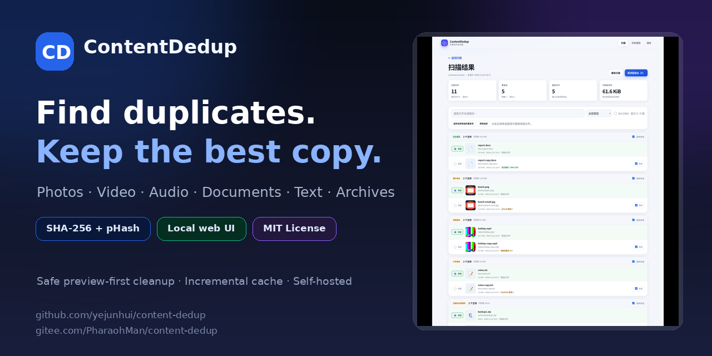
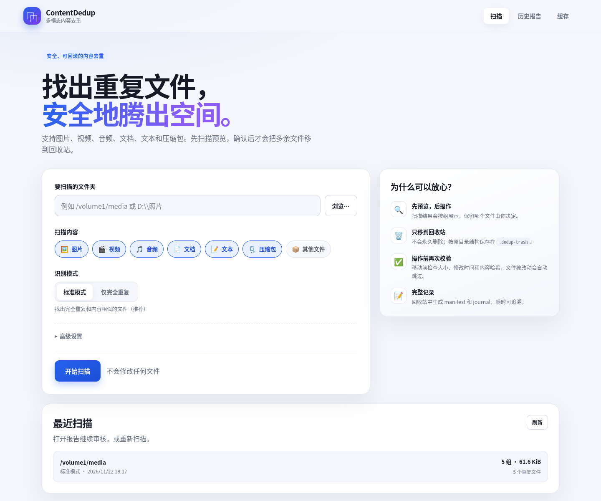
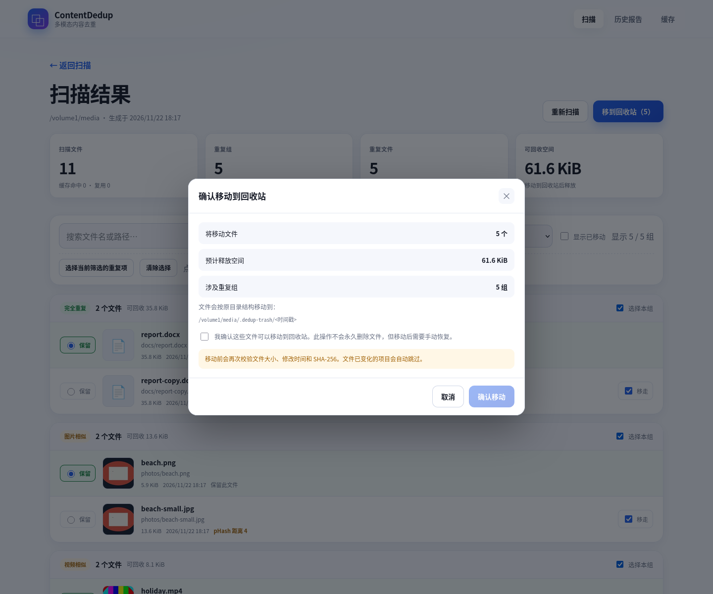
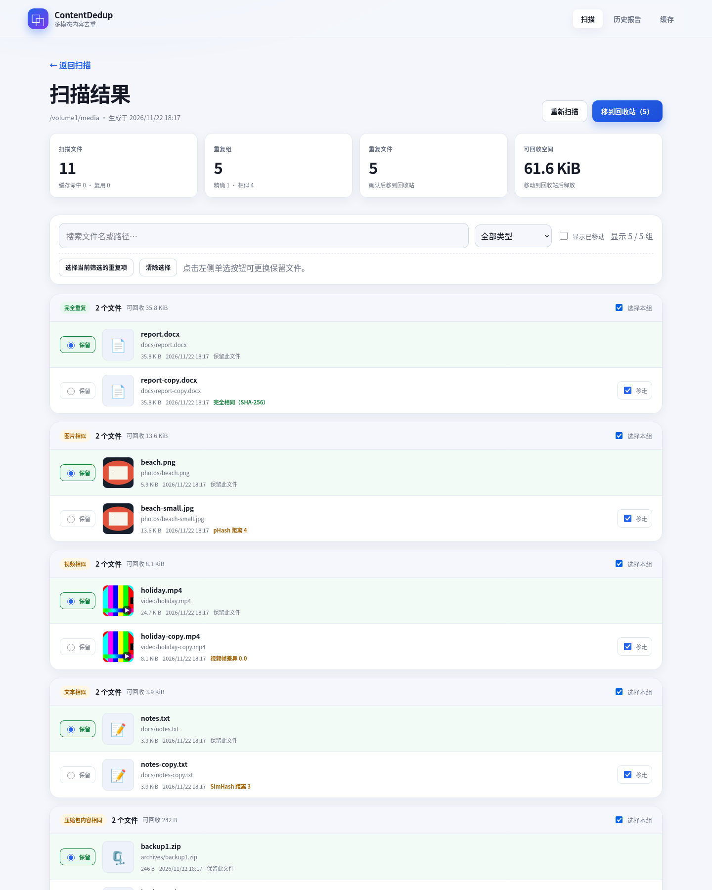

<div align="center">
  

  <h1>ContentDedup</h1>

  <p><strong>本地、安全、可回滚的多模态内容去重工具</strong></p>
  <p>图片 · 视频 · 音频 · 文档 · 文本 · 压缩包</p>

  <p>
    <a href="https://github.com/yejunhui/content-dedup/actions/workflows/ci.yml"></a>
    <a href="https://www.python.org/"></a>
    <a href="LICENSE"></a>
    <a href="Dockerfile"></a>
    <a href="https://gitee.com/PharaohMan/content-dedup"></a>
    <a href="https://github.com/yejunhui/content-dedup/stargazers"></a>
  </p>

  <p>
    <a href="README.md">中文</a> ·
    <a href="README.en.md">English</a> ·
    <a href="https://github.com/yejunhui/content-dedup">GitHub</a> ·
    <a href="https://gitee.com/PharaohMan/content-dedup">Gitee</a>
  </p>
</div>

> **先预览，再清理。** ContentDedup 找出完全重复和“看起来一样”的文件，由你确认保留哪个，再把多余文件移入回收站。完全本地运行，不上传文件；不会直接永久删除。

---

## 为什么值得用

大多数去重工具只比较文件字节。ContentDedup 关心的是**内容**：

- 🖼️ 同一张照片的 PNG、压缩 JPEG、缩小版，可以识别为同一组
- 🎬 重新编码、改分辨率后的视频，可以按抽帧 pHash 序列匹配
- 🎵 不同码率的同一首歌，可以用 Chromaprint 音频指纹匹配
- 📄 PDF / DOCX / XLSX / PPTX / ODF / EPUB，提取文本后用 SimHash 找近似文档
- 🗜️ 重新压缩、重新打包但内容相同的 zip/tar，可以识别
- 🧠 完全重复仍走 SHA-256，保证精确、快速、无误差

同时，它优先考虑普通用户和安全：

- **Web 图形界面**：文件夹选择器、缩略图、进度条、取消、逐组审核
- **默认安全**：CLI 清理默认 dry-run；Web 清理必须二次确认
- **只移到回收站**：保留原目录结构，写 `manifest.json` + `journal.jsonl`
- **操作前再校验**：大小、修改时间和 SHA-256 都会重新检查
- **NAS 友好**：SQLite 增量缓存、分阶段扫描、资源限制、Docker

## 界面预览

<p align="center">
  
  
</p>

<p align="center">
  
</p>

## 30 秒上手

### 方式一：Docker（推荐 NAS / 服务器）

```bash
git clone https://github.com/yejunhui/content-dedup.git
cd content-dedup

# 把 /volume1/media 换成你的媒体目录
MEDIA_DIR=/volume1/media docker compose up -d
```

打开 `http://<NAS-IP>:8765/`。

- 媒体目录需要**可写**，Web 清理才能把重复项移动到 `.dedup-trash`
- 缓存、报告、缩略图保存在 Docker 命名卷 `content-dedup-state` 中
- 镜像已包含 ffmpeg 和 Chromaprint `fpcalc`
- 容器内以 UID 1000 运行；如果 NAS 媒体目录属于其他 UID，请调整 compose 的 `user:` 或目录权限
- 停止：`docker compose down`（不会删除媒体）

> ⚠️ Web 控制台默认没有登录认证。Docker 端口只建议暴露在可信局域网，或使用 VPN / 反向代理认证。

### 方式二：本地 Python + Web 界面

```bash
git clone https://github.com/yejunhui/content-dedup.git
cd content-dedup

python3 -m venv .venv
. .venv/bin/activate
pip install -e .

# 可选：视频抽帧/缩略图、音频指纹
sudo apt-get install -y ffmpeg libchromaprint-tools

# macOS: brew install ffmpeg chromaprint
# Windows: 安装 ffmpeg，并把 fpcalc 加入 PATH

./start-web.sh
# 等价于: dedup web --open
```

默认打开 `http://127.0.0.1:8765/`。只想浏览某个目录：

```bash
dedup web --root /volume1/media --open
```

### 方式三：命令行

```bash
# 标准模式：精确 + 相似
dedup scan /volume1/media \
  --types image,video,document \
  --report /volume1/reports/latest.json

# 只要完全重复，速度最快
dedup scan /volume1/media --mode exact --report /volume1/reports/exact.json

# 查看报告
dedup report --report /volume1/reports/latest.json

# 清理：默认 dry-run，仅打印计划
dedup apply --report /volume1/reports/latest.json

# 确认后真正移动到 .dedup-trash
dedup apply --report /volume1/reports/latest.json --yes
```

想先体验？生成一组演示文件再扫描：

```bash
python examples/create_demo.py ./demo
dedup web --root ./demo --open
```

## 核心能力

| 内容类型 | 精确匹配 | 结构/感知指纹 | 说明 |
|---|---|---|---|
| 图片 | SHA-256 | pHash / dHash + RGB 颜色直方图 | 识别缩放、重压缩；颜色差异过大时拒绝 |
| 视频 | SHA-256 | 抽帧 pHash 序列 + DTW + 颜色直方图 | 识别重编码、分辨率变化；时长差过大不比较 |
| 音频 | SHA-256 | Chromaprint（`fpcalc`） | 缺 `fpcalc` 时自动降级为仅精确去重 |
| PDF / Office / ODF / EPUB | SHA-256 | 文本提取 + SimHash | 同内容不同格式导出可匹配 |
| 纯文本 / 代码 / Markdown | SHA-256 | SimHash + 3-token shingles | 过短文本只做精确匹配 |
| zip / tar / gz / bz2 / xz | SHA-256 | 内部 `(路径, 大小, SHA-256)` 清单 | 识别重新压缩、重新打包 |
| 其他二进制 | SHA-256 | — | 只做精确去重，避免误判 |

### 它怎么判断“相似”

1. **精确层**：所有类型统一 SHA-256 分组，完全相同零误判。
2. **结构层**：
   - 图片：32×32 灰度 DCT → 64 位 pHash；颜色直方图二次校验
   - 视频：按间隔抽帧，每帧 pHash，序列用 DTW 对齐，另加时长和颜色门控
   - 音频：Chromaprint 原始指纹，在时间轴上平移对齐
   - 文档/文本：tokenize → unigram + shingle → 64 位 SimHash
   - 压缩包：解压成员内容哈希 → 排序 → 清单哈希
3. **索引层**：64 位汉明距离使用分段 banding 索引，先取候选再精确校验。
4. **聚类层**：星型聚类，keeper 必须与每个重复项直接满足阈值，避免链式误合并。
5. **语义层**：预留 CLIP / 文本 embedding 接口，本版本未启用。

## 安全设计

ContentDedup 不是“一键删文件”工具：

- CLI `apply` **默认 dry-run**；Web 必须勾选确认并点击确认按钮
- 重复项只移动到 `<扫描根>/.dedup-trash/<时间戳>/`，保留原相对路径
- 每次移动前重新校验文件大小、mtime 和内容 SHA-256；文件变化会自动跳过
- 每组记录 keeper 与每个重复项的判定依据（精确、pHash 距离、SimHash 距离、音频相似度）
- 写 `manifest.json` 和逐条 `journal.jsonl`，方便追溯
- 不提供永久删除接口
- 建议 NAS 执行前打 Btrfs 快照，并把 trash 放在可回滚卷

Web 安全：

- 默认只监听 `127.0.0.1`
- 使用 `--root /data` 限制可浏览/扫描范围
- 局域网访问请设置防火墙；当前版本没有登录认证
- 不要直接暴露到公网

## 配置

完整默认值见 [`config.yaml`](config.yaml)。常用项：

```yaml
scan:
  workers: 1
  min_size: 1
  exclude: [".git", "@eaDir", "#recycle", ".dedup-trash"]

image:
  algorithm: phash          # phash | dhash
  phash_threshold: 8        # 0..64
  color_threshold: 0.85

video:
  frame_interval: 5.0
  max_frames: 240
  phash_threshold: 10
  duration_tolerance: 0.2
  color_threshold: 0.8
  max_pair_comparisons: 200000

audio:
  enabled: true
  fpcalc: fpcalc
  min_score: 0.9
  duration_tolerance: 0.15

document:
  simhash_hamming: 3
  min_tokens: 20

text:
  simhash_hamming: 3
  min_tokens: 20
  max_bytes: 4000000

safety:
  keep: oldest              # oldest | newest | largest | shortest_path
  trash_dir: .dedup-trash
  verify_on_apply: true

storage:
  database: .dedup/cache.sqlite3
  report: .dedup/reports/latest.json
```

距离/相似度阈值只影响分组，不触发指纹重算；影响指纹内容或可用性的参数（如 `hash_size`、`min_tokens`、`frame_interval`）会自动使缓存失效。

## 增量缓存

SQLite 缓存保存：

```text
path, size, mtime_ns, adapter, exact_hash,
fingerprints(JSON), fp_status, fp_error,
fp_sig, cache_version, updated_at
```

- 文件路径、大小、mtime、适配器、算法签名不变时直接复用
- `mode=exact` 只缓存精确哈希；之后跑 `mode=all` 会复用 SHA-256、只补指纹
- 指纹失败/不支持也会缓存，避免 NAS 每次重复付出代价；`--refresh` 强制重试
- 外部工具可用性（`fpcalc`、ffmpeg/ffprobe）计入签名；安装工具后自动失效
- SQLite 建议放在本地卷；不要同时运行多个 scan 进程写同一个缓存

## 命令说明

### `scan`

| 参数 | 说明 |
|---|---|
| `ROOT` | 扫描根目录 |
| `--config` | YAML 配置；不传时读取当前目录 `config.yaml` |
| `--types` | `image,video,audio,document,text,archive,binary` 子集 |
| `--mode` | `exact` / `fingerprint` / `all` |
| `--db` | SQLite 缓存路径，默认 `.dedup/cache.sqlite3` |
| `--report` | JSON 报告路径（相邻生成 `.md`） |
| `--limit` | 最多处理 N 个文件，遍历到 N 后提前停止 |
| `--workers` | 并行哈希/指纹线程数，NAS 建议 1–2 |
| `--min-size` | 跳过小于 N 字节的文件 |
| `--follow-symlinks` | 跟随符号链接，仅建议用于分析 |
| `--refresh` | 忽略缓存重算 |
| `--no-semantic` | 显式关闭语义层（当前默认关闭） |

### `report` / `apply` / `cache`

```bash
dedup report --report reports/latest.json --top 50
dedup apply  --report reports/latest.json              # dry-run
dedup apply  --report reports/latest.json --yes        # move to trash

dedup cache stats
dedup cache prune
dedup cache clear --yes
```

`apply` 重新校验内容；`--no-verify` 可跳过内容哈希，但仍检查 size/mtime（不建议）。

### `web`

```bash
dedup web [--host 127.0.0.1] [--port 8765] [--root DIR] [--open]
```

Web 模式默认使用：

```text
.dedup/cache.sqlite3     增量缓存
.dedup/reports/          扫描报告
.dedup/thumbnails/       缩略图缓存
```

可用 `--db`、`--reports`、`--thumbs` 覆盖。

## Docker / NAS

镜像包含：

- Python 3.13
- ffmpeg / ffprobe
- Chromaprint `fpcalc`
- Pillow / numpy / 文档解析依赖

构建并运行：

```bash
docker build -t content-dedup .
docker run --rm -p 8765:8765 \
  -v /volume1/media:/data \
  -v content-dedup-state:/state \
  content-dedup
```

`docker-compose.yml` 使用命名卷保存缓存、报告和缩略图。若需要直接在宿主机查看 JSON/Markdown 报告，可把 `/state` 改成 bind mount：

```yaml
volumes:
  - "${MEDIA_DIR:-./media}:/data"
  - "${STATE_DIR:-./state}:/state"
```

并确保运行容器内 UID 1000 对 `state/` 和需要清理的媒体目录有写权限：

```bash
mkdir -p state
sudo chown -R 1000:1000 state
```

NAS 建议：

1. 先 `--mode exact` 快速拿到完全重复
2. 再按类型分批跑结构指纹
3. 视频/音频单独错峰执行
4. `--workers 1`，限制 CPU
5. 执行前打 Btrfs 快照
6. 大库按目录拆分，避免 `max_pair_comparisons` 上限

## 性能与规模

- 精确哈希：顺序读文件，SHA-256，内存占用低
- 图片：缩到 32×32 灰度后 DCT；颜色直方图 4×4×4
- 视频：抽帧后只保留 32×32 RGB，不落盘临时帧
- 音频：`fpcalc` 默认分析前 120 秒
- 文档：文本提取有 `max_chars` / `max_pages` 限制，超限只做精确去重
- 相似索引：banding 候选生成，避免全量 O(n²)
- 视频/音频：时长门控 + 快速预筛 + 对比较次数上限
- 增量缓存：重复扫描只处理新增/修改文件

## 架构

```text
src/dedup/
├── adapters/             # 图片/视频/音频/文档/文本/压缩包/二进制
├── fingerprints.py       # pHash、dHash、SimHash、DTW、音频相似度
├── index.py              # 分段汉明索引
├── pipeline.py           # 枚举、缓存、并发、进度、取消
├── grouping.py           # 精确桶 + 星型聚类
├── store.py              # SQLite 增量缓存
├── report.py             # JSON / Markdown 报告
├── cleanup.py            # 安全移动、按选择清理
├── config.py             # 配置加载/校验
├── cli.py                # scan / report / apply / cache / web
└── web/                  # 本地 Web 控制台
    ├── server.py         # HTTP + JSON API
    ├── jobs.py           # 后台扫描/清理任务、目录浏览
    ├── thumbnails.py     # 图片/视频缩略图
    └── static/           # HTML/CSS/JS，无 CDN / Node 构建
```

更早的方案推演见 [设计笔记](docs/design.md)。

## 常见问题

**会上传我的文件吗？**  
不会。所有扫描、指纹、缩略图和清理都在本机完成，没有云服务依赖。

**会永久删除文件吗？**  
不会。只移动到 `.dedup-trash`；Web 和 CLI 都不提供永久删除接口。

**为什么没有发现重复？**  
确认开启了“标准模式”、勾选了对应内容类型，并检查阈值。短文本（默认少于 20 tokens）、旧版二进制 Office、无文本层扫描 PDF 只做精确去重。

**和 fdupes / rmlint 有什么区别？**  
fdupes 等主要做精确重复。ContentDedup 增加了图片/视频/音频/文档/文本的结构指纹、Web 审核界面、回收站与操作前校验。

**能在群晖/威联通/NAS 上跑吗？**  
可以。推荐 Docker；也可以 Python 安装后用 `dedup web --root /volume1/media`，缓存放在本地卷。

**如何恢复？**  
从 `<扫描根>/.dedup-trash/<时间戳>/` 按原相对路径取回。目录下有 `manifest.json` 和 `journal.jsonl`。当前 Web 版本暂未提供一键恢复页面。

**支持 Windows / macOS 吗？**  
支持 Python 3.11+ 的平台；视频需要 ffmpeg，音频指纹需要 Chromaprint `fpcalc`。Web 界面跨平台。

**语义向量层呢？**  
接口和配置已预留，当前版本未实现；`semantic.enabled: true` 会明确报错。

## Roadmap

- [x] 精确 + 结构指纹全类型
- [x] 本地 Web 控制台、缩略图、进度与取消
- [x] 安全回收站、manifest/journal、操作前校验
- [x] SQLite 增量缓存
- [x] Docker / docker-compose 与 CI
- [ ] 一键恢复回收站页面
- [ ] Web UI 英文界面 / i18n
- [ ] 语义向量层（CLIP / 文本 embedding）
- [ ] 可选 FAISS / HNSW 语义索引
- [ ] 7z / rar / zst 内部清单，HEIC/AVIF 开箱支持
- [ ] PyPI 发布与版本化二进制包

## 参与贡献

欢迎 Issue、PR、适配器、文档和真实使用反馈。

- 开发与测试：[CONTRIBUTING.md](CONTRIBUTING.md)
- 更新记录：[CHANGELOG.md](CHANGELOG.md)
- 安全问题：[SECURITY.md](SECURITY.md)
- 行为准则：[CODE_OF_CONDUCT.md](CODE_OF_CONDUCT.md)
- GitHub Issues：https://github.com/yejunhui/content-dedup/issues
- Gitee 镜像：https://gitee.com/PharaohMan/content-dedup

如果这个项目对你有帮助，欢迎点一个 ⭐ Star，让更多人发现它。

## License

[MIT](LICENSE) © 2026 yejunhui
